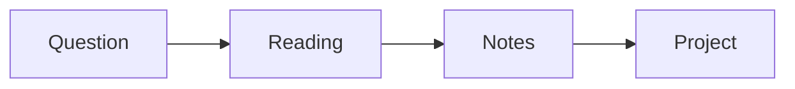

## Headings and text

This is a **sample** learning note. It exists so you can preview how notes look. Copy the structure, then delete this file. Inline code looks like `np.mean(x)`, and links look like [this](https://nextjs.org).

### A nested heading

Nested headings appear indented in the “On this page” menu.

## Maths

Inline maths: $E = mc^2$. Display maths:

$$
\sigma(z) = \frac{1}{1 + e^{-z}}
$$

## Code

```ts
export function greet(name: string) {
  return `Hello, ${name}!`;
}
```

## Diagrams



## Tables

| Column | Another column |
| --- | --- |
| A cell | Another cell |

> A quotation looks like this.
