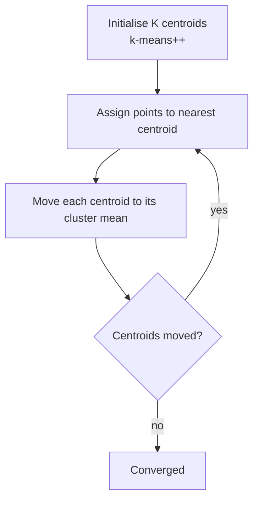

## Overview

K-means partitions $n$ points into $K$ clusters so that each point belongs to the cluster with the nearest mean (centroid). It is fast, simple and often the first clustering method to try.

> This page currently pairs a short explanation with an interactive, in-browser demo on synthetic data. The from-scratch implementation and its repository are in progress.

## Mathematical Intuition

K-means minimises the within-cluster sum of squares, also called **inertia**:

$$
J = \sum_{k=1}^{K} \sum_{x_i \in C_k} \lVert x_i - \mu_k \rVert^2
$$

where $\mu_k$ is the mean of the points in cluster $C_k$. Finding the global optimum is NP-hard, so we use a greedy alternating procedure that only ever decreases $J$.

## How It Works

Lloyd’s algorithm alternates two steps until assignments stop changing:

1. **Assign** each point to its nearest centroid.
2. **Update** each centroid to the mean of the points assigned to it.



**k-means++** initialisation picks each new starting centroid with probability proportional to its squared distance from the centroids already chosen, which spreads them out and usually converges faster to a better solution.

## Implementation from Scratch

```python
import numpy as np

def kmeans(X: np.ndarray, k: int, iters: int = 100, seed: int = 0):
    rng = np.random.default_rng(seed)
    centroids = X[rng.choice(len(X), size=k, replace=False)]
    for _ in range(iters):
        dists = ((X[:, None, :] - centroids[None, :, :]) ** 2).sum(-1)
        labels = dists.argmin(axis=1)
        new = np.array([
            X[labels == j].mean(axis=0) if np.any(labels == j) else centroids[j]
            for j in range(k)
        ])
        if np.allclose(new, centroids):
            break
        centroids = new
    return centroids, labels
```

## Strengths and Limitations

- **Strengths:** simple, scales well, easy to explain.
- **Limitations:** you must choose $K$; it assumes roughly spherical, similar-sized clusters; results depend on initialisation; and it is sensitive to outliers and feature scale. Density-based methods such as DBSCAN handle irregular shapes and noise better.

## References

- Lloyd, S. (1982). *Least squares quantization in PCM.* IEEE Transactions on Information Theory.
- Arthur, D. & Vassilvitskii, S. (2007). *k-means++: The advantages of careful seeding.* SODA.
