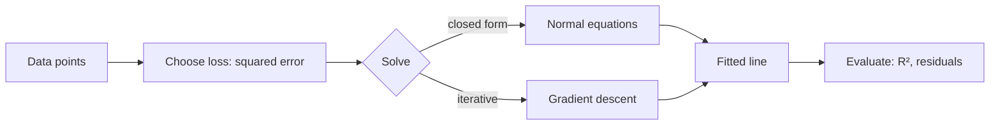

## Overview

Linear regression models a continuous target $y$ as a weighted sum of input features plus an intercept. It is the simplest supervised model worth understanding deeply, because almost every idea in it — a loss function, a closed-form optimum, gradient descent, residual analysis — reappears in more complex models.

> This page currently pairs a short explanation with an interactive, in-browser demo on synthetic data. The from-scratch implementation and its repository are in progress.

## Why It Matters

- It is a strong, interpretable baseline: if a complex model can’t beat it, the complexity isn’t paying for itself.
- Its coefficients are directly readable as “how much $y$ changes per unit of $x$”.
- Generalised linear models, regularised regression and neural-network output layers all build on it.

## Mathematical Intuition

For one feature, the model predicts

$$
\hat{y} = \beta_0 + \beta_1 x
$$

Ordinary least squares chooses $\beta_0, \beta_1$ to minimise the sum of squared residuals:

$$
\mathcal{L}(\beta_0, \beta_1) = \sum_{i=1}^{n} \left(y_i - \beta_0 - \beta_1 x_i\right)^2
$$

Setting the partial derivatives to zero gives the closed-form solution

$$
\beta_1 = \frac{\sum_i (x_i - \bar{x})(y_i - \bar{y})}{\sum_i (x_i - \bar{x})^2}, \qquad \beta_0 = \bar{y} - \beta_1 \bar{x}
$$

In matrix form, with a design matrix $X$, the normal equations give $\hat{\beta} = (X^\top X)^{-1} X^\top y$.

## How It Works



### Gradient descent

Instead of solving exactly, we can step downhill along the gradient with learning rate $\eta$:

$$
\beta_j \leftarrow \beta_j - \eta \,\frac{\partial \mathcal{L}}{\partial \beta_j}
$$

## Implementation from Scratch

A minimal NumPy version of both approaches:

```python
import numpy as np

def fit_closed_form(X: np.ndarray, y: np.ndarray) -> np.ndarray:
    """Return [intercept, coefficients...] via the normal equations."""
    Xb = np.c_[np.ones(len(X)), X]
    return np.linalg.lstsq(Xb, y, rcond=None)[0]

def fit_gradient_descent(X, y, lr=0.01, epochs=2_000):
    Xb = np.c_[np.ones(len(X)), X]
    beta = np.zeros(Xb.shape[1])
    for _ in range(epochs):
        grad = -2 / len(y) * Xb.T @ (y - Xb @ beta)
        beta -= lr * grad
    return beta
```

## Evaluation and Results

| Metric | What it tells you |
| --- | --- |
| $R^2$ | Share of the variance in $y$ explained by the model |
| MSE / RMSE | Average squared (or root squared) prediction error |
| Residual plot | Whether errors look random, or reveal a pattern the model missed |

## Strengths and Limitations

- **Strengths:** fast, interpretable, a closed-form optimum, well-understood statistics.
- **Limitations:** assumes a linear relationship, is sensitive to outliers (squared loss), and coefficients become unstable when features are highly correlated.

## References

- Hastie, Tibshirani & Friedman — *The Elements of Statistical Learning*, chapter 3.
- James, Witten, Hastie & Tibshirani — *An Introduction to Statistical Learning*, chapter 3.
