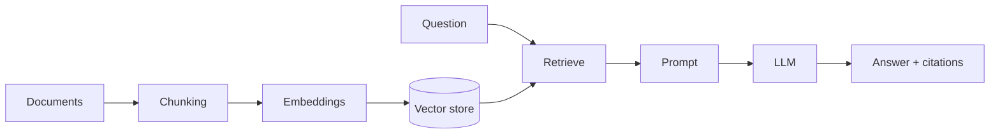

<!-- Template B — applied AI system. Delete sections you don't need. -->

## Problem Statement
## Users and Requirements
## Constraints
## Proposed Solution
## System Architecture

## Technical Implementation
## Product and Engineering Decisions
## Evaluation
## Deployment
## Results and Impact
## Limitations and Learnings
## Future Improvements
